# Vagnstrid

_Hobbyprojekt · Godot 4.7 · Linköping i skala 1:1_

Du är vagnchefen. **Allt du vet om fienden ser du med egna ögon.**

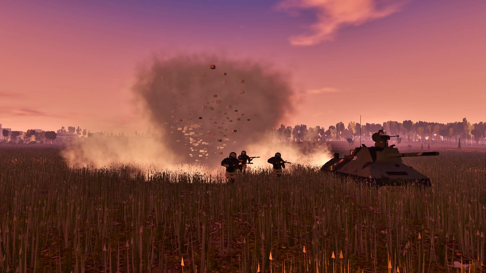

## Luckan: spelets kärnidé

Vagnstrid är ett halvrealistiskt stridsvagnsspel i War Thunders anda, men med ett eget grepp: spelaren sitter som vagnchef i kupolen, och det finns inga markörer ovanför fienden i 3D-världen. Upptäckter syns bara som tecken på minikartan.

Öppen lucka ger fri sikt runt om och kikare, men chefen sticker upp och kan träffas av splitter, spränggranater, kulsprutor och infanteriets gevär. Stängd lucka skyddar, men då ser du världen genom en smal periskopspringa. Hela spelet är byggt kring det beslutet, och bottarna fattar exakt samma beslut under exakt samma regler.

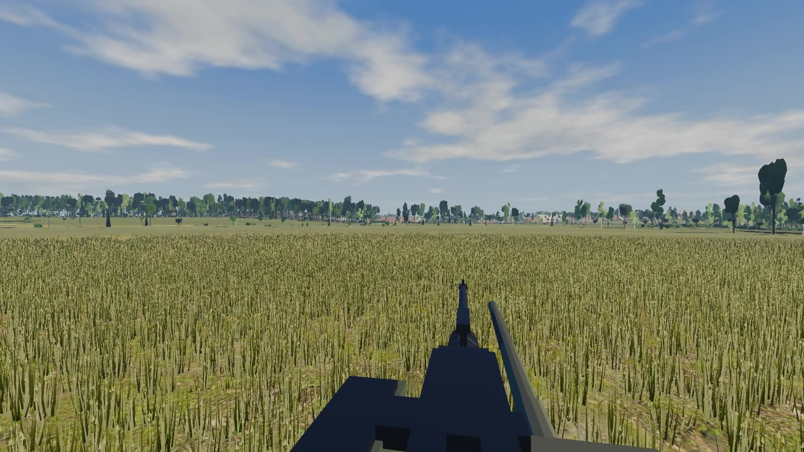

_H · Lucka öppen_

### Hela horisonten

360° sikt, kikare (B) och takkulspruta. Locket bakom chefen skyddar ryggen mot kulor och splitter, men inte framifrån.

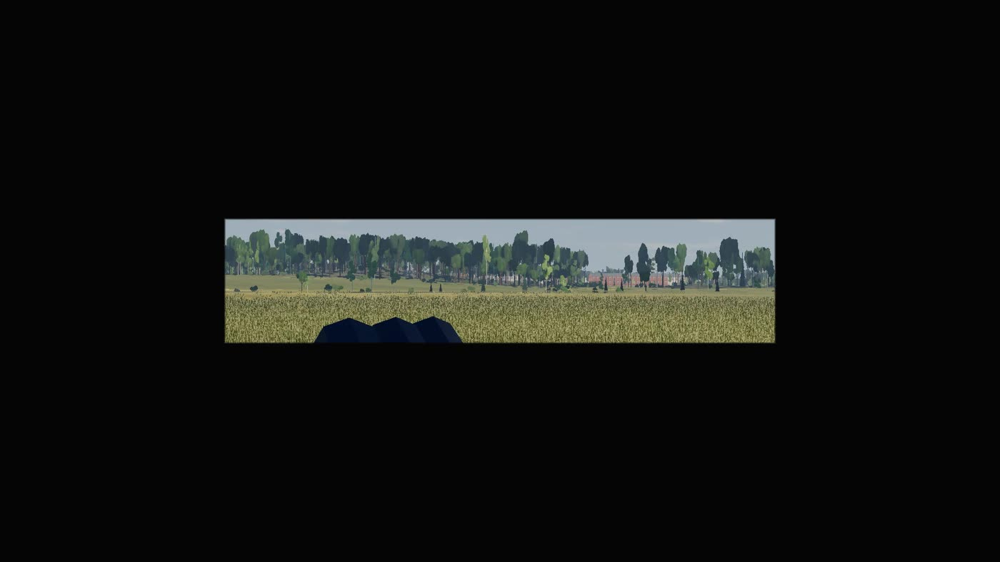

_H · Lucka stängd_

### En springa i mörkret

Skyddad mot allt utom pansarbrytande granater, men bara en smal sektor framåt. Ljudet utifrån dämpas också.

Inga röda trianglar. Ser du inte fienden, så vet du inte var han är.

## Stridsvagnarna

Få vagnar, mycket känsla. Varje vagn har en tydlig styrka och en tydlig svaghet. Modellerna är fritt inspirerade av klassiska förebilder och byggs helt i kod: `TankModel` skapar både utseendet och pansarformerna från samma data, så en sluttande pansarplåt är verkligen sluttande. Träffvinkeln räknas från ytnormalen, och granaten kan studsa.

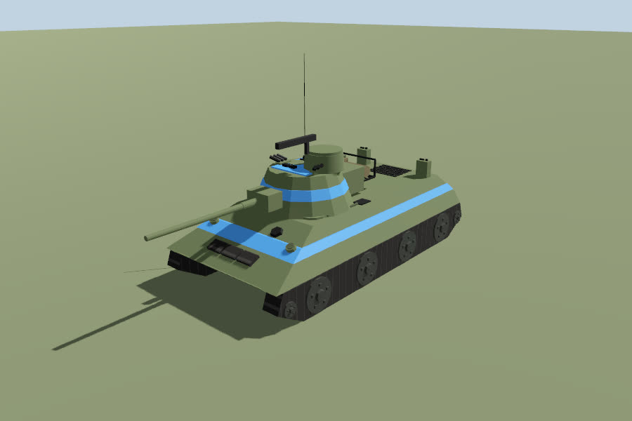

### BT-7

_Spanare · flankör_

**Styrka:** Snabbast av alla, 54 km/h. Laddar om på 2,5 s och vrider tornet snabbast. Sluttande skrov som kan få 37–75 mm att studsa.

**Svaghet:** Kommer inte igenom någons front. 25 mm pansar och 50 hp: allt som träffar gör ont.

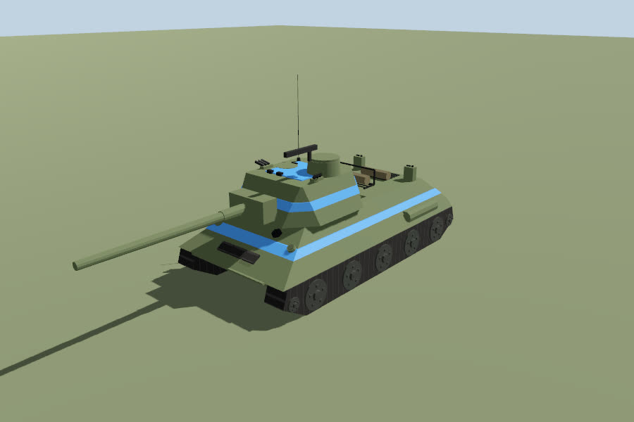

### T-34

_Slagskämpe_

**Styrka:** Sluttande pansar, bäst i terräng (klättrar 36°, vadar lätt), kraftig spränggranat, 47 km/h och snabb omladdning (5,5 s).

**Svaghet:** Sämst optik (28–15° sikte) och 100 mm genomslag.

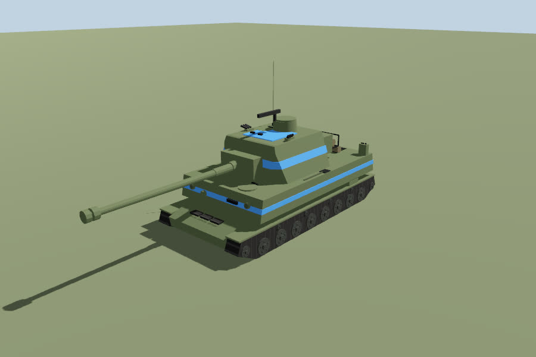

### Pz IV

_Prickskytt_

**Styrka:** 145 mm genomslag i 630 m/s, starkast sikte (30–8°), 80 mm skrovfront.

**Svaghet:** 36 km/h, långsamt torn (14,9°/s), 6,5 s omladdning, 50/30 mm torn och bara 20 mm bak.

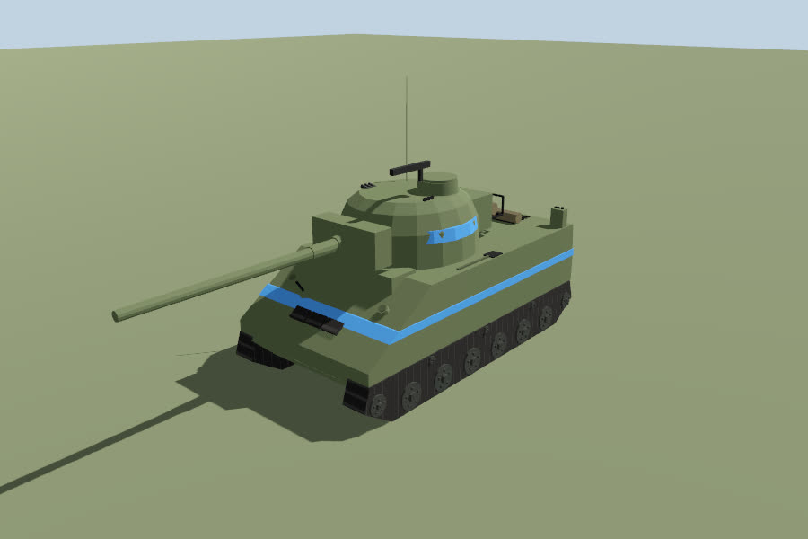

### Sherman

_Allroundare i rörelse_

**Styrka:** Kanonstabilisator (50 %, upp till 4°/s): skjuter under jämn körning. Tornet ×1,3, 5 s omladdning, fyra rökomgångar.

**Svaghet:** Hög silhuett: upptäcks snabbare. 39 km/h och medelmåttigt pansar.

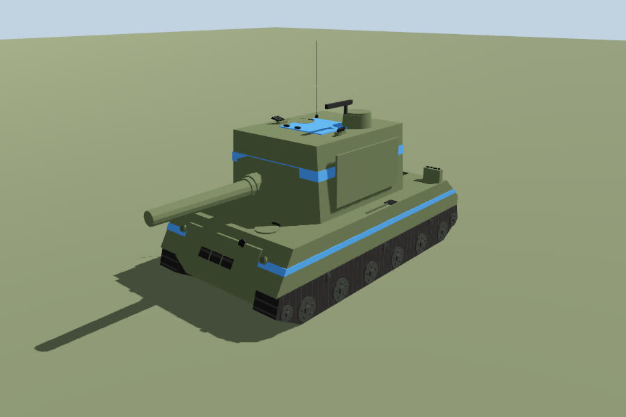

### KV-2

_Genombrytare_

**Styrka:** 152 mm haubits: 120 hp skada (AP), spränggranat som fäller träd i 12 m radie. 100 mm front, 140 hp.

**Svaghet:** 15 s omladdning, 330 m/s (kraftig båge), 30 km/h, tornet släpar (10,7°/s).

| Vagn | Vikt | Fart fram/back | Skrov F/S/B mm | Torn F/S/B mm | AP pen | AP skada | HE skada | Ladd | Sikte (FOV) |
|---|---|---|---|---|---|---|---|---|---|
| BT-7 | 13,3 t | 54 / 10 | 25/25/13 | 25/15/15 | 60 | 18 | 10 | 2,5 s | 30–12° |
| T-34 | 28,5 t | 47 / 9 | 45/35/40 | 70/52/45 | 100 | 40 | 30 | 5,5 s | 28–15° |
| Pz IV | 27,8 t | 36 / 7 | 80/50/20 | 50/30/30 | 145 | 34 | 25 | 6,5 s | 30–12–8° |
| Sherman | 30,1 t | 38 / 7 | 51/38/38 | 76/51/51 | 100 | 37 | 25 | 5,0 s | 30–12° |
| KV-2 | 65,6 t | 30 / 6 | 100/62/28 | 111/47/37 | 130 | 120 | 80 | 15 s | 30–12° |

Värdena är utlästa ur spelets data idag via `TankBuilder.build()`, med T-34:ans och Pz IV:ans omladdningstider bytta (gren `t34-pz4-reload`). Pansar är verklig tjocklek; sluttningen räknas av modellens geometri.

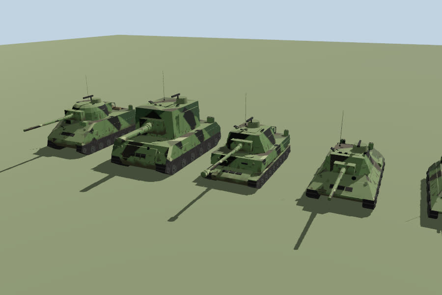

_Sett från motståndarsidan: fiender bär ett M90-liknande splittermönster._

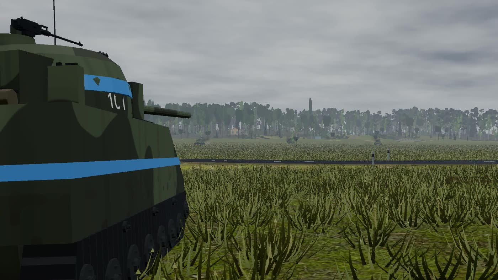

_Egna lag: olivgrönt, väderbitet, med FN-blå band och taktiskt nummer på tornet._

Varje spelare ser sitt eget lag blåmärkt och alla andra kamouflerade; färgerna väljs på din egen dator utifrån vilket lag du är i. Målningen åldras i matchen. Damm växer med körsträckan, regn gör vagnen blöt, lera sitter längs banden. Hjul snurrar och banddelar rör sig efter faktisk körning, väghjulen följer marken, antennen gungar med accelerationen, och packning, presenningsrullar och dunkar varierar per vagn.

## Varje granat flyger, varje träff (be)räknas

Granaterna är simulerade, inte strålar: de har gravitation, luftmotstånd (kvadratiskt) och flygtid, och integreras med Heun-metoden så att de landar där sikteskalan säger oavsett tickrate. Träffar räknas med en stråle från förra positionen till nästa i varje fysiksteg.

- **Pansar:** riktig plåttjocklek, vinkel från ytnormalen, rikoschettvinkel per chassi (63–70°), överkalibrering från kaliber/plåt 2,5 och aldrig studs från 6.

- **Moduler** längs granatens väg: motor, bränsle, band, tornring, ammunition, förare och skytt. Motorskada halverar farten, tornringen bromsar tornet, ett trasigt band immobiliserar.

- **Ammunitionen** slår ut vagnen och kastar tornet i luften (men aldrig rakt framifrån inom 40°). Bränsle ger brand.

- **Besättningen** såras men dör inte. En sårad förare eller skytt blir groggy, och spelet lägger då in en fördröjning i kontrollerna: föraren reagerar 0,3–0,9 s sent på gas och styrning, skytten 0,2–0,5 s sent på riktning, kanon och kulspruta, och siktet glider. Efter 60 s utan nya sår är de som vanligt igen. Samma regel gäller bottarna.

- **Plåtslitage:** träffar som inte går igenom försvagar just den plåtcellen.

- **Reparation:** stå still och moduler lagas, band på 20–30 s. Ett genomslag eller brand startar om klockan.

- **Vrak** ligger kvar hela matchen och kan knuffas undan (35 % av vagnens massa).

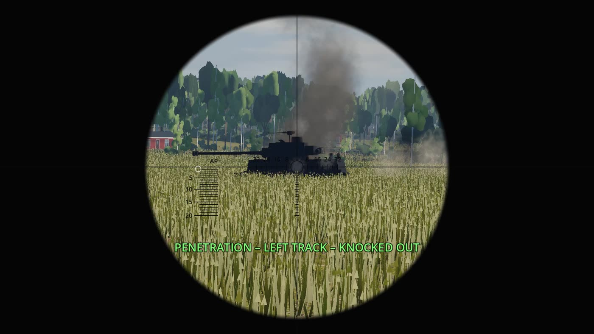

_Skyttesiktet: avståndsskala, omladdningsring och träffresultat. Ingen hp-mätare för fienden, aldrig._

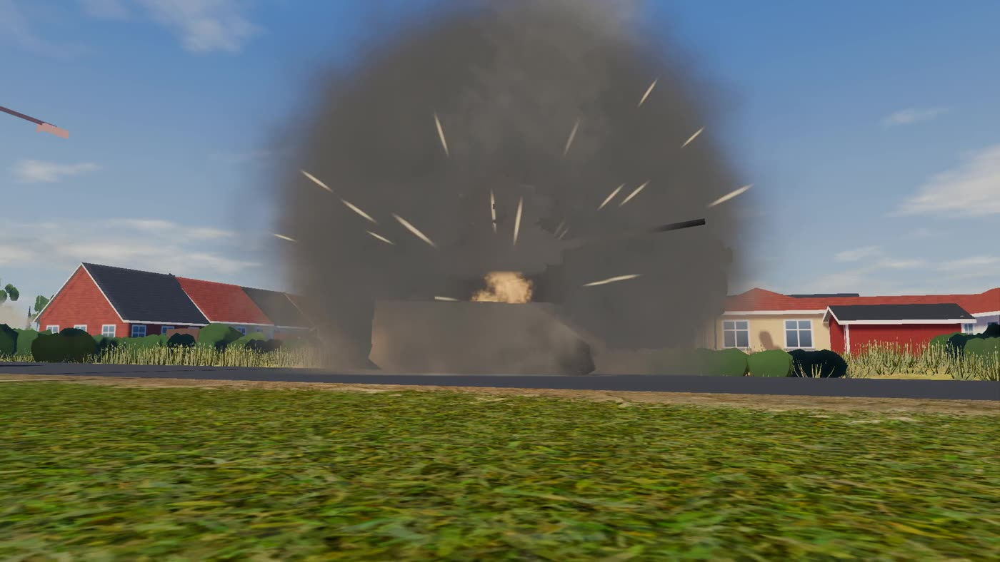

_Ammunitionen tar eld …_

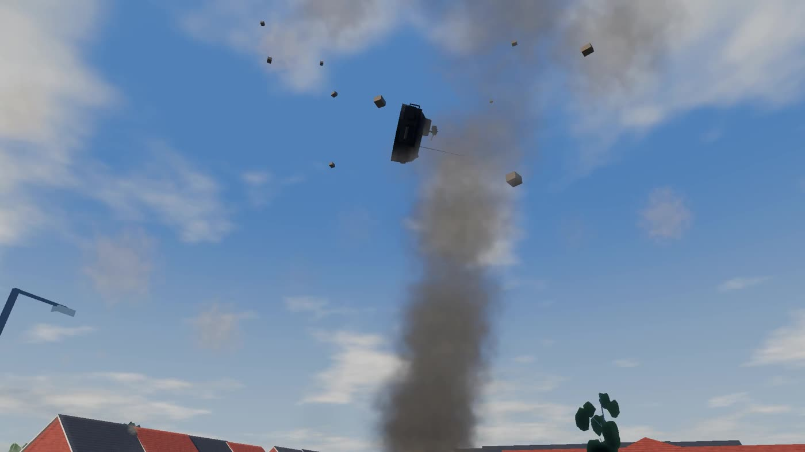

_… och tornet kastas. En förkolnad stelkropp som landar där fysiken säger._

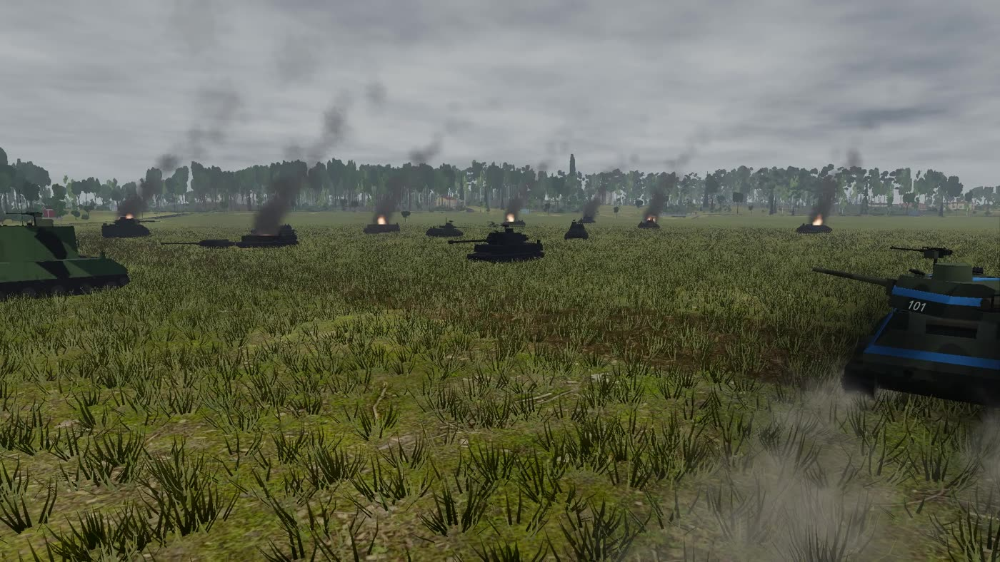

_Vrak blir terräng: skydd att gömma sig bakom, eller att knuffa undan med en KV-2._

#### Killcam

Utslagen? Den dödande granaten spelas upp med en jaktkamera, sedan visas en träffbild av din egen vagn ovanifrån och från sidan med alla träffar under livet. Därefter följer du närmaste lagkamrat.

#### Kill feed och assist

"T-34 → Pz IV" i lagfärg. Assist räknas för allt som gjorde verklig skada, även splitter från en nära miss som slog ut en modul.

#### Fastkörd eller på sidan?

Gasar eller styr du i 10 s utan att komma loss får vagnen en liten knuff, och har den lagt sig mer än 60° ställs den upp igen. Vatten djupare än 1,6 m spärrar vidare framfart som kartkanten.

## Spräng skadar, pansarbrytande dödar

#### AP – pansarbrytande

Genomslag = `pen × fart / mynningsfart`. Skadan beror på marginalen: med en halv kaliber till godo full skada, knappt igenom 35 % och skytten läser "WEAK PENETRATION". Går igenom trädstammar, avlänkas 5–15° och tappar 15 % fart.

#### HE – spräng

Studsar aldrig. Utan genomslag tar den ändå strukturskada och slår mot exponerade moduler (motor, tornring), bryter bandet den landar på och smutsar ned fiendens optik inom 8 m. Fäller träd: 6 m radie för 75 mm, 12 m för 152 mm.

#### Byte och laddning

Med en granat i slutstycket tar ett byte 40 % av omladdningen. Under pågående laddning byts bara typen; tiden kvar står kvar. Inga genvägar.

#### Kulsprutor

Koaxial kulspruta och en M2-liknande takkulspruta (500 skott/min, bara med öppen lucka). Band om 100 skott, 6 s omladdning. Kulsprutekulor går igenom stammar upp till 0,25 m.

#### Rök

`X` skjuter en rökomgång framför tornet: 3 salvor per liv (Sherman 4), 20 s cooldown. Röken driver med vinden, följer marken och skymmer sikten lika för spelare och bottar.

#### Ingen vådaeld (Friendly fire off)

Egna granater gör ingen skada på laget, och explosioner skonar skyttens lag.

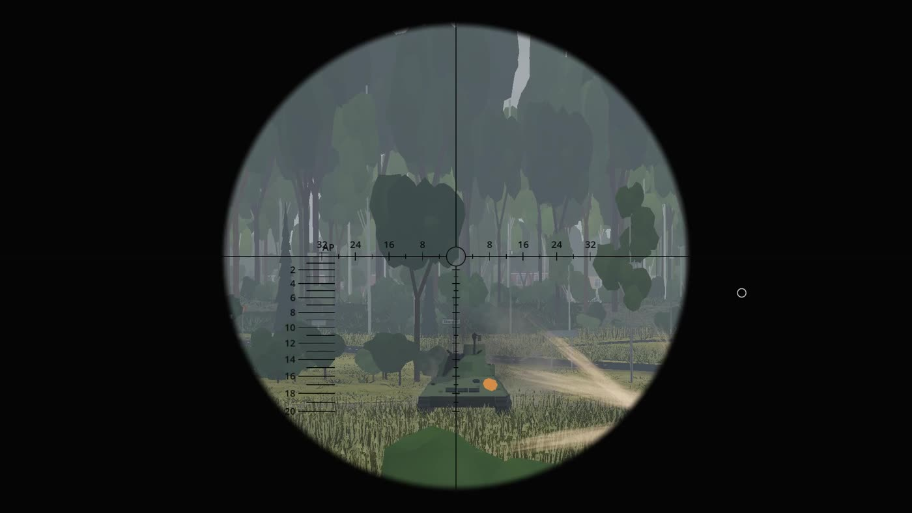

_Skytten zoomar steglöst med mushjulet mellan siktets vidaste och smalaste läge._

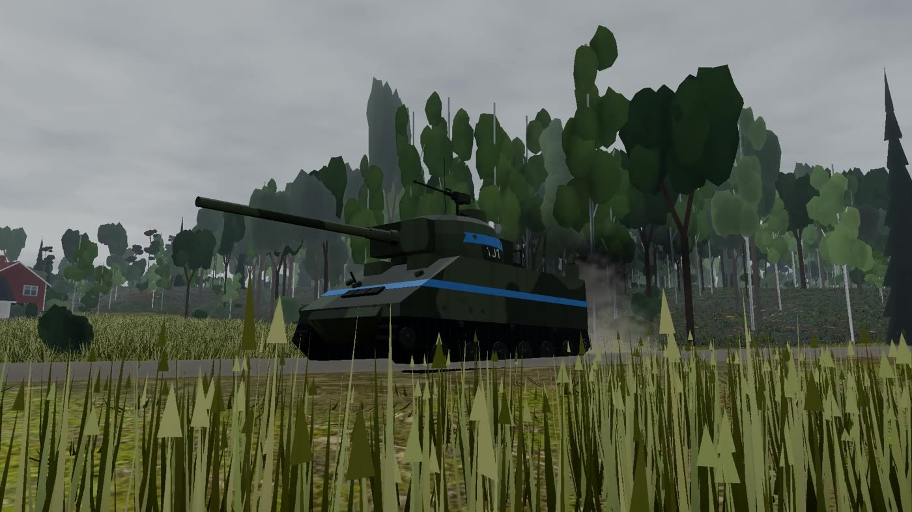

_Skott avslöjar: mynningsflamma, krutrök och tungt avgas gör en vagn lättare att upptäcka._

## Samma ögon för alla

Bottarna har ingen genväg. De upptäcker bara via siktlinjer från sin egen vagnchefs öga: luckan öppen ger runtomsikt, långt och snabbt; stängd bara periskopsektorn. Ju fler av vagnens fyra skrovpunkter (och en exponerad chef) som syns, desto snabbare går det.

- **Skyl:** buskar, trädkronor och träd genererade från Lantmäteriets laserdata (laserträd) runt målet bromsar upptäckten, särskilt när vagnen står still.

- **Markvegetation:** gräs, gröda, vass, sly och ljung per 2-meterscell. Den andel av kroppen som döljs, gånger en betningsfaktor (fullt längs marken, inget sett uppifrån från 35°), styr upptäckt. Spelaren ser samma strån utritade, ända ut till 800 m i kikaren.

- **Väder:** sikten kapas till väderleksens sikt, och upptäckt tar längre tid i dimma och regn.

- **Optiksmuts** efter en HE-smäll: suddig bild för spelaren, upp till 2,5× långsammare upptäckt för bottar.

- **Spotting:** klicka i chefsvyn för att märka en fiende. Märket syns bara på lagets karta och bleknar.

Inställningsmenyn får aldrig låta en spelare se mer än en bot: dimma, träd och fjärrvegetation finns inte som val.

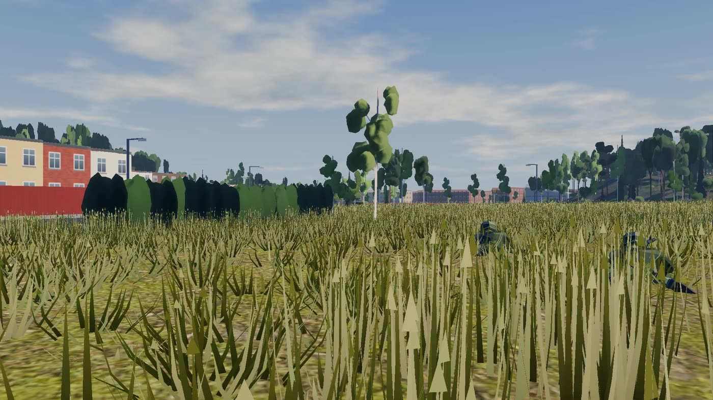

_Liggande soldater i ett fält. Lika svåra att se för en bot som för dig._

## Avsittning

Varje vagn bär en grupp på fyra soldater. Du styr dem aldrig direkt; du ger order, och de klarar sig själva.

På Q-kartan skickar du gruppen (vänsterklick), lägger minor (högerklick), kallar hem den (G) eller låter den gå som närskydd framför vagnen (F). Med V ser du genom gruppchefens ögon: titta och märk mål, men ingen styrning. Gruppen rapporterar på svenska över radion: *"Avsittning!"*, *"Skott kommer! Klart bakåt!"*, *"Mina armerad!"*, med klockslag från vagnens skrov.

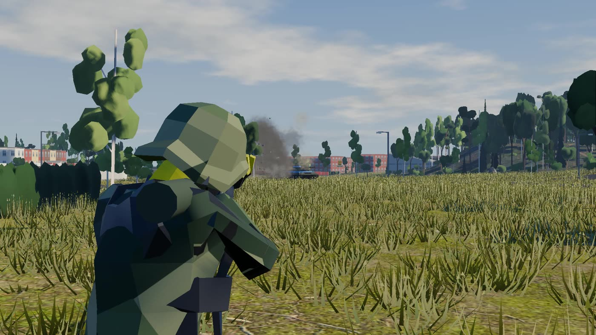

_Pansarskytten ställer sig, ropar och skjuter efter 3 s. Siktar på bandet som vetter mot honom._

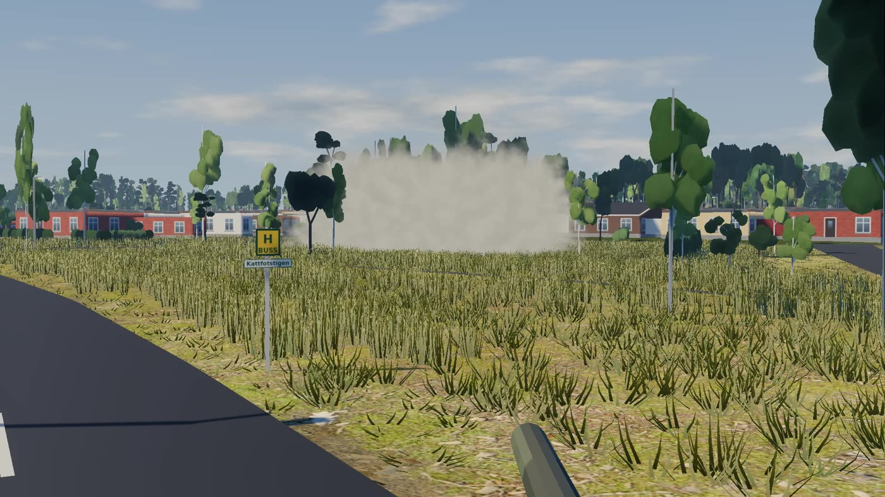

_Med två man nere kastar gruppen rökgranat och drar sig tillbaka._

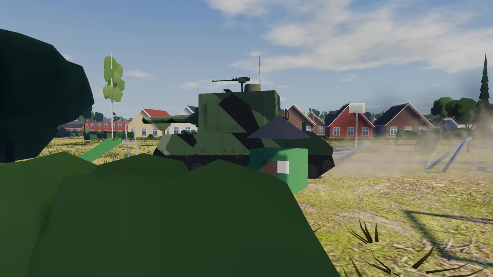

_Bakhåll vid lekplatsen. Lekredskapen faller isär när en vagn kör in i dem._

#### Utrustning

Varje man bär antingen ett pansarskott eller en mina (två och två). Faller han, försvinner hans del. Uppsuttet fylls det på: en man i minuten, utrustning 20 s efter.

#### Pansarskott

30 mm-laddning som bryter band och skakar optiken. Slår bara ut en vagn som redan är under 15 % hp, aldrig ammunitionen, aldrig brand. Sällsynt men möjligt; kill feed säger "Bazooka".

#### Minor

Magnetisk tändare: en fiendevagn över minan förlorar ett band och tar 10 hp, aldrig utslagen. Fiendesoldater kan hitta den; den visas då som ett rött kryss på deras karta. Bottar planerar runt kända minor.

#### Bakhåll och strid

Står gruppen still lägger den sig och håller elden. Fiendeinfanteri inom 55 m: gruppen anfaller i par, ett par springer medan det andra skjuter. Överraskade grupper sprider skotten mer.

#### Rörelse

Soldaterna går en och en med egen takt, rundar hus, klättrar max 45° och väljer egna skyddade platser 4–9 m runt gruppens punkt. Kör en fiendevagn över dem, så faller de.

#### Animation

Mixamo-rörelser bakade på en CC-BY-modell: knäböj, liggande, eldställningar, övergångar och dödsfall per ställning. En av dem heter Wilhelm.

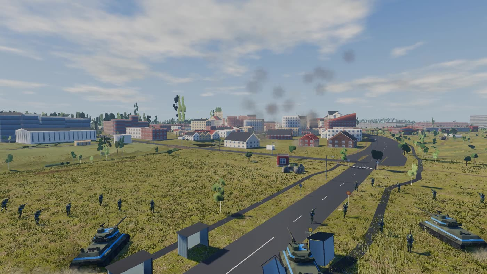

_Sju T-34:or och deras grupper avancerar mot Vallastaden. Spränggranater i fältet._

## Motståndare som läser terrängen

Bottarna följer samma regler som spelare: samma kommandon, samma sikt, samma upptäckt. De ser inte genom busken du står bakom. Varje karta har ett bakat taktiskt rutnät (8 m-celler med höjd, hus, vatten, branter, skog, väg, våtmark och skyl), där A* med straff för öppna siktlinjer/genomfart och upprätning av vägen ger rutter som följer trädrader och skydd hellre än öppna fält.

#### Positioner

`find_position` poängsätter platser efter skyl, skrovskydd (hull down), siktlinjer från chefens öga och avstånd till lagkamrater.

#### Språng och överblick

Par rör sig i tur och ordning: en bevakar, en kör till nästa läge. Långa transporter går via en flank så rutterna varierar.

#### Eld och rörelse

Efter ett skott backar boten till skydd medan den laddar och kliver fram några meter åt sidan. Under eld: stanna och svara, eller lägga rök och dra sig undan.

#### Närstrid

En fiende inom 50 m blir mål direkt, och boten kör runt mot sidan eller bakdelen och skjuter i rörelse.

#### Roller

Spanare (som växlar till störande roll / *harasser* vid kontakt), slagskämpe, prickskytt, flankör och genombrytare. Var och en med sin väg in, sitt avstånd och sitt tålamod.

#### AI-befälhavaren

En osynlig `TeamCommander` per lag läser striden i tre körfält och väljer huvudinsats, skickar jägare mot prickskyttar, flyttar försvaret mot hotad sida och lägger bakhåll med infanteriet.

AI-befälhavaren är uppmätt, inte gissad. I 40 matcher per variant (6 mot 6 på Thunder Road) vann laget som flyttade försvaret mot den hotade sidan 23, förlorade 8, med +1,57 checkpoints per match mot +0,12 utan. I King of the Hill visade sig huvudinsats och bakhåll förlora (att samla allt på en sida förlorar där flest vagnar i zonen vinner), så där är bara försvarsflytten påslagen.

## Tre sätt att spela

### King of the Hill

_Vidingsjö · Linghem · Campus_

En aktiv zon i taget öppnar, krymper över tid och delar ut poäng tills zonens poäng-pott är tömd. Den bestrids aldrig: varje lag får poäng per egen vagn i zonen, och laget med flest där får en multiplikator. Utslag i zonen ger bonus, assist 15 personliga poäng.

Zonerna vandrar: nästa plats väljs längs fronten mellan lagen, med jämn väg och skyl från båda håll. Startplatserna följer zonen. Bottarna anfaller längs tre axlar, samlas parvis och lägger minor på fiendens väg in.

### Thunder Road

Vidingsjö Röd & Orange · Road to Science · Corson · Linghem · Vidingsjö XL

Ett genombrott längs en riktig väg. Anfallarna tar nästa checkpoint genom att vara fler än försvararna i zonen. Varje checkpoint har 6 minuter (9 på XL). Ett erövrat checkpoint flyttar fronten, ger fler gemensamma liv och en ny våg.

Försvaret gör en stridande reträtt (40 s): linjen hoppar bakåt, och den som blir kvar gör ett sista motstånd. Båda lagen anfaller en runda var; flest checkpoints vinner. Korridorer håller striden nära vägen. Den som lämnar sin korridor blir märkt och slås ut efter 30 s. Svensk radio: *"Fall tillbaka till ÅSA tre."*

### Fri strid

_Vidingsjö · Linghem · Campus_

Spelarna (co-op) mot vågor av bottar. Vågen gräver ned sig utom synhåll och väntar tills någon upptäcks eller blir träffad, sedan anfaller hela vågen och kryper närmare för varje framryckning. Varannan våg lätt, varannan svår, och svårare för varje runda.

Bot-allierade kan följa med på spelarnas lag. Matchen är över när ingen spelare lever.

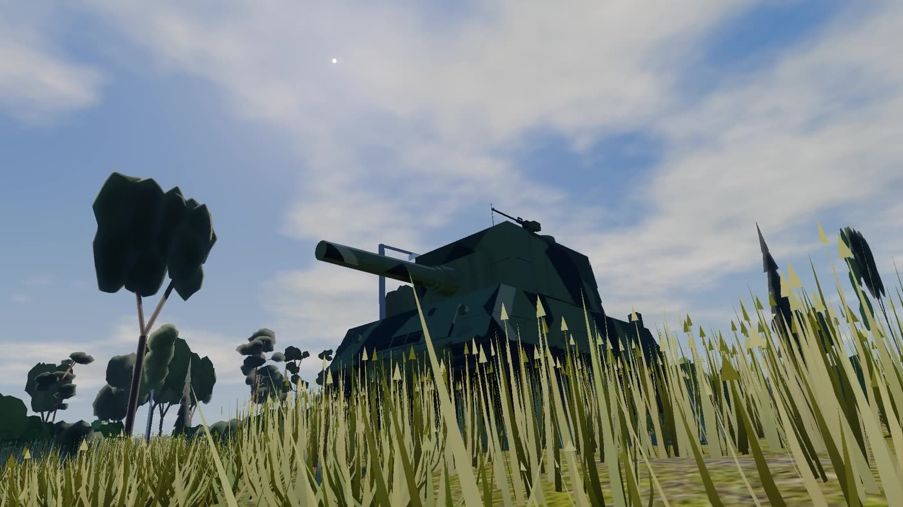

_KV-2 i ett fält i Vidingsjö._

## Linköping i skala 1:1

Sex aktiva kartor byggda från öppna geodata över verkliga platser i Linköping. Hus, vägar, häckar, lyktstolpar och trafikljus kommer från öppen data, så spelet stämmer med verkligheten: det som står i ett gathörn i Vallastaden står där i spelet också. Skogstyp lottas per träd utifrån marktäckedata och tät skog/snår hämtas även från orienteringskartor. 14 scenarier bygger på kartorna (scenen ärver kartan, så ändringar följer med).

| Karta | Plats | Storlek | Yta | Spellägen |
|---|---|---|---|---|
| Vidingsjö | Villaområde och åkrar, Linköping | 3,38 × 3,05 km | 10,3 km² | KotH, Thunder Road ×2, Fri strid |
| Vidingsjö XL | Blästad – Berga – Garnisonen | 5,17 × 4,73 km | 24,5 km² | Thunder Road (7,1 km, 6 zoner) |
| Road to Science | Vallastaden – Universitetet – Mjärdevi | 4,44 × 3,81 km | 16,9 km² | Thunder Road (4,55 km) |
| Linghem | Tätort med järnväg | 1,74 × 2,58 km | 4,5 km² | KotH, Thunder Road, Fri strid |
| Campus | Campus Valla | 2,04 × 1,84 km | 3,8 km² | KotH, Fri strid |
| Corson | Malmslättsvägen – Campus Valla | 1,71 × 2,74 km | 4,7 km² | Thunder Road |

- **64,5 km²** spelbar yta totalt
- **6** kartor från verkliga data
- **14** scenarier
- **2 m** höjdupplösning i terrängen

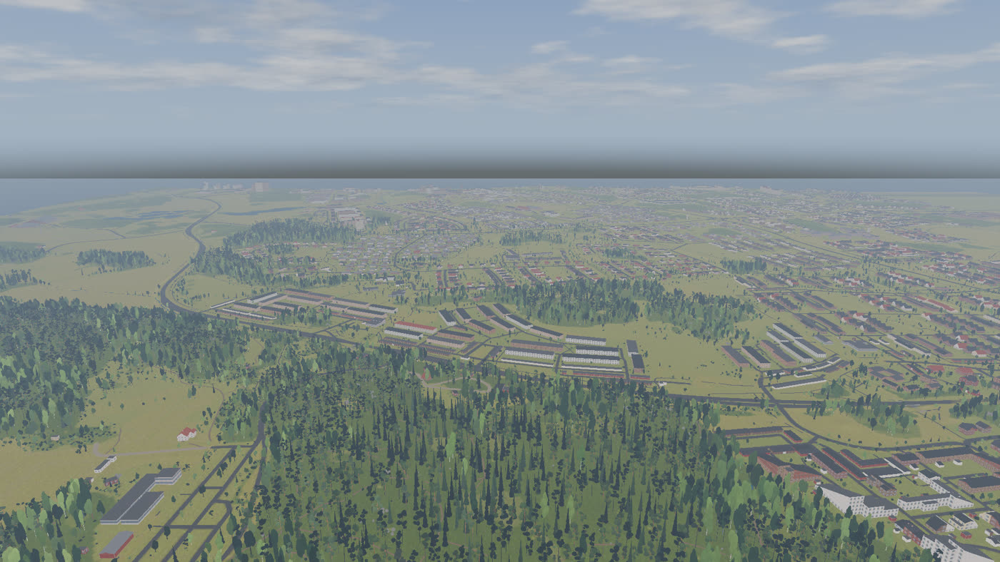

_Vidingsjö från ovan: trädpositioner från laserdata med trädslag lottade från marktäckedata._

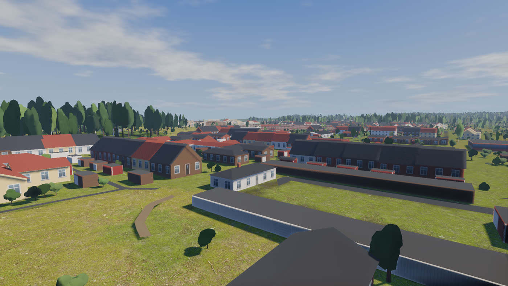

_Hus med fasader, fönster och takfärger ur flygfoto._

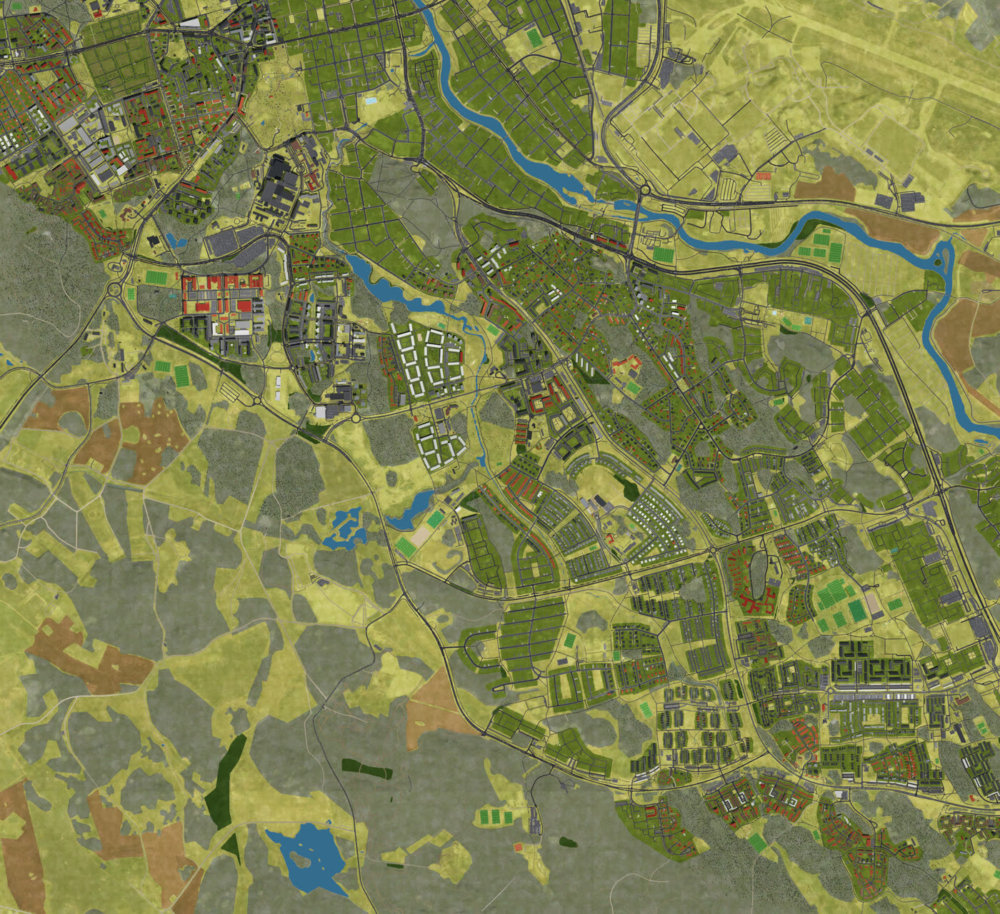

_Minikartan för Vidingsjö XL renderas ur spelet självt, ovanifrån. M öppnar den stora kartan._

## Från öppna data till slagfält

En egen Python-pipeline i `geodata/` (55 skript, cirka 17 000 rader) hämtar data för ett område, bygger terräng, hus, vägar och vegetation och importerar allt till Godot. Ett nytt område är ett kommando: `nytt_omrade.py <namn> <hörn> <hörn>`.

Två GPS-punkter räcker för en ny karta. Ange två hörn på en rektangel, så sköter skripten resten: de hämtar data från alla källor nedan, formar terrängen, bygger hus, vägar, träd och gatumöbler, importerar allt till Godot och skapar kartans scen. Efter 20–30 minuter finns en ny karta över en verklig plats. Verktygen är byggda med Claude Code.

| Källa | Vad den ger spelet |
|---|---|
| Lantmäteriet – laserpunktmoln och höjdmodell | Terräng i 2 m, enskilda träd med höjd, nya hus som saknas i OSM, takfot och nock, häckar (laser 0,5–2,8 m i raka band) |
| Lantmäteriet – ortofoto 16 cm | Takfärger, markfärg (Vidingsjö), uppfarter, rättning av vägbredder och mittlinjer |
| OpenStreetMap | Vägar, hus, järnväg, vatten, lekplatser, skyltar, trafikljus, ortnamn, parkeringar, löparbanor |
| Trafikverket NVDB | Verklig vägbredd, beläggning, hastighet, övergångsställen, trummor |
| Naturvårdsverket NMD (NMD2023) | Marktäcke (skog, åker, våtmark, hårdgjort) samt tilläggsskikt trädslag (10 m raster: tall, gran, triviallöv, ädellöv) som klipps med `klipp_nmd.py` och lottas per laserträd i `step4_trees.py` |
| Jordbruksverket | Åkerblock och vilken gröda som växer var |
| Mapillary | Positioner för gatlyktor, vägskyltar och gatumöbler ur gatubilder |
| Copernicus DEM | Höjddata där laser saknas |
| Orienteringskartor (privat bruk) | Stenblock, snår, myr och öppen mark |
| Egna foton och GPS-punkter | Handplacerade detaljer på campus: konstverk, Corsons lampor, Studenthusets fasad, Blå havet |

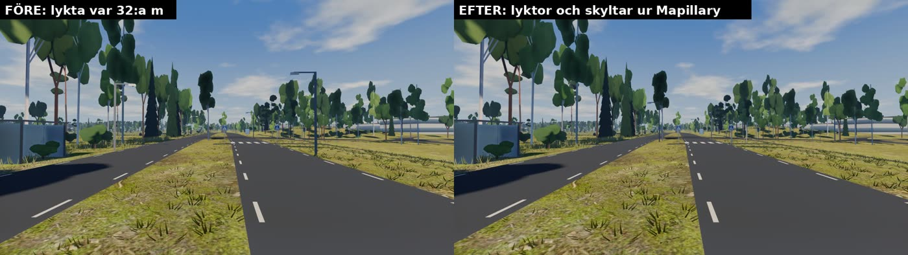

_Gatlyktor var 32:a meter (före) mot lyktor och skyltar där Mapillary har sett dem (efter)._

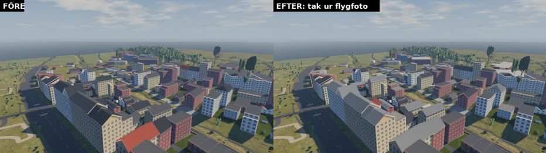

_Vallastadens tak i spelet: före, och efter att takfärgerna lästs ut ur flygfotot._

#### Väg och gata

- Vägmarkeringar, väjningslinjer, svängpilar, farthinder och busshållplatser

- Trottoarer med 12 cm kantsten, refuger och GC-vägar

- Asfaltsshader med lagningar, oljefläckar, hjulspår och vattenpölar i regn

- Diken, vägräcken på höga bankar, reflexstolpar och ortnamnsskyltar

#### Saker som välter

- Lyktstolpar, kontaktledningsstolpar (med ledningen), skyltar, busskurer och gravstenar

- Trafikljus som faktiskt växlar, med gångsignal, och slocknar när de körs ned

- Lekplatser med unika redskap per park, som faller isär

#### Natur

- Träd från laserdata med art lottad via NMD2023-andelar i `step4_trees.py` (gran, tall, björk, ek) och detaljnivåer; tät skog och snår kompletteras från orienteringskartor. Vagnar knuffar omkull träd åt sidan, granater fäller dem

- Sjöar med djup, vadning och vass längs stranden

- Broar, undergångar, järnvägsbank och perrong (Linghem)

## Grått, blött och på svenska

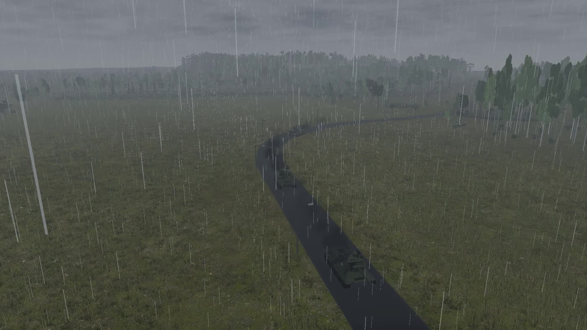

_En kolonn i regn. Regnstrimmor, droppar på optiken, våt asfalt och trummande tak._

**Väder:** klart, mulet, gryning, skymning, dimma och regn. Egen himmelsshader med moln, färggradering per väder och vind som driver moln, avgaser, krutrök, brandrök och rökridåer. Sikten styr både vad du ser och hur långt bottar ser.

**Ljud:** varje knall kommer med ljudets hastighet: ett avlägset skott hörs efter att du sett blixten. Med stängd lucka dämpas världen utanför; kanonskott tränger ändå igenom. En studsande granat ger ett metalliskt "ping".

**Röster:** besättningen ropar *"Vi är träffade!"*, *"Närträff!"*, *"Föraren träffad!"* och, vid en hård krock, *"Lugn nu, Rally-Kalle!"*. Gruppen och stridsledningen pratar på radio, och stridsledningen har egna repliker för zonbyten, reträtter och sista minuten. Inspelade med ElevenLabs.

## Byggt för 20 mot 20

#### Värdstyrt

Värden simulerar allt. Klienter skickar kommandon 30 gånger i sekunden och får packade ögonblicksbilder 20 gånger i sekunden, cirka 38 byte per vagn. Ungefär 0,8 kB/s per vagn och mottagare.

#### Rättvist

Fiendens hp skickas aldrig. Egen vagns torn och lucka förutsägs lokalt; andra vagnar interpoleras 100 ms bakåt.

#### Lobby och byte

Välj lag och vagn i matchen. Bottar fyller ut lagen och lämnar plats när spelare ansluter. Byt lag via Esc, eller be någon på andra sidan att byta.

#### Dedikerad server

`--dedicated`: bottar fyller lagen, matchen slutar, alla röstar på nästa karta. Loggar matcher och röster som JSON. Systemd-tjänst ingår.

## Teknik och prestanda

- **37 200** rader GDScript i 195 skript, statiskt typat
- **145** datafiler (.tres): all balans i data
- **30 Hz** fysik, med interpolering till skärmens takt
- **219** commits sedan 1 november 2026

### Motor

- **Godot 4.7**, Forward+, **Jolt Physics**, Terrain3D för terrängen.

- Vagnar läser aldrig input. Tangentbord, bot-AI och nätverk producerar samma `TankCommand`. Därför kan bottar och nätverksspel köra samma kod.

- Fjädring med strålar, bandkrafter, tryckning mot vrak och vagnar, vadning och djupt vatten.

- Fordonen, husen, broarna, träden, lekplatserna och gatumöblerna genereras i kod. Inga köpta modeller.

### Prestanda

- **VagnFast**, en C++-GDExtension för heta loopar: fjädring för alla vagnar på arbetstrådar, bandkrafter, och en gemensam världsbild per fysiksteg som alla bottar läser. GDScript-versionen finns kvar som reserv.

- Bottarnas och gruppernas spaningsvarv körs på 11 trådar (`ScanBatch`), kontrollerade identiska mot huvudtråden över 281 461 jobb.

- Lätta bildrutor: dyrt arbete läggs i rutor utan fysiksteg. Bottar långt från spelare tänker i halv takt men följer samma regler.

- 10 mot 10: 59–60 fps med vsync. 20 mot 20: cirka 25–38 fps på en RX 5700 XT.

Verktyg runt spelet: bakning av taktiska rutnät, kartbilder ovanifrån, fasta jämförelsevyer med GPU-tider, renderingar av vagnar och effekter, hela bot-matcher som mäter lagbefälet, och manusstyrda trailerscener som filmas med Godots Movie Maker. Bilderna här kommer därifrån.

## Tangenterna

| Tangent | Gör |
|---|---|
| `WASD` | Kör |
| `Mus 1` | Skjut (sikte) / spotta (chefsvy) |
| `Mus 2` | Kulspruta |
| `Hjul` | Zoom i siktet |
| `H` | Lucka |
| `B` | Kikare |
| `T` | Vrid tornet dit chefen tittar |
| `X` | Rök |
| `Q` | Skyttegrupp: karta, order och minor |
| `G` | Skyttegrupp: kalla hem |
| `F` | Skyttegrupp: närskydd |
| `V` | Skyttegrupp: gruppchefens ögon |
| `M` | Stor karta |
| `Tab` | Resultattavla |
| `F1` | Hjälp |
| `F3` | Statistik: fps och nät |
| `Esc` | Meny: byt vagn, byt lag, överge |

## Köra spelet

**Färdigt bygge:** packa upp och starta `Vagnstrid.exe` (Windows) eller `Vagnstrid.x86_64` (Linux).

**Från källkoden:** installera [Godot 4.7](https://godotengine.org/download), öppna mappen som
projekt och tryck F5. Första importen tar en stund, eftersom kartorna är stora.

Systemkrav: ett grafikkort med Vulkan-stöd. Kartorna är detaljerade, så ett medelstarkt
spelkort från de senaste åren rekommenderas.

## För utvecklare

[CLAUDE.md](CLAUDE.md) är projektets regler och tekniska översikt (skriven för Claude Code, men
läsbar för människor). Kartpipelinen beskrivs i [geodata/CLAUDE.md](geodata/CLAUDE.md), och
[EXPORTERA.md](EXPORTERA.md) beskriver hur man bygger spelet. Alla data, modeller, ljud och
bibliotek står i [CREDITS.md](CREDITS.md) (och under Credits i huvudmenyn).

---

Vagnstrid är ett hobbyspel som inte ges ut. Koden är skriven med Claude Code. Kartdata: OpenStreetMap-bidragsgivare (ODbL), Lantmäteriet (CC BY 4.0), Naturvårdsverket NMD, Trafikverket NVDB, Jordbruksverket, Mapillary (CC BY-SA 4.0), Copernicus DEM. Soldat: KolosStudios (CC BY 3.0), animationer Mixamo. Ljud: Freesound och Kenney (CC0). Röster: ElevenLabs. Texturer: ambientCG (CC0). Ikon: Google Gemini.

Alla bilder är renderade i spelet: trailerscener, jämförelsevyer och nya vagnrenderingar från 23 november 2026.
