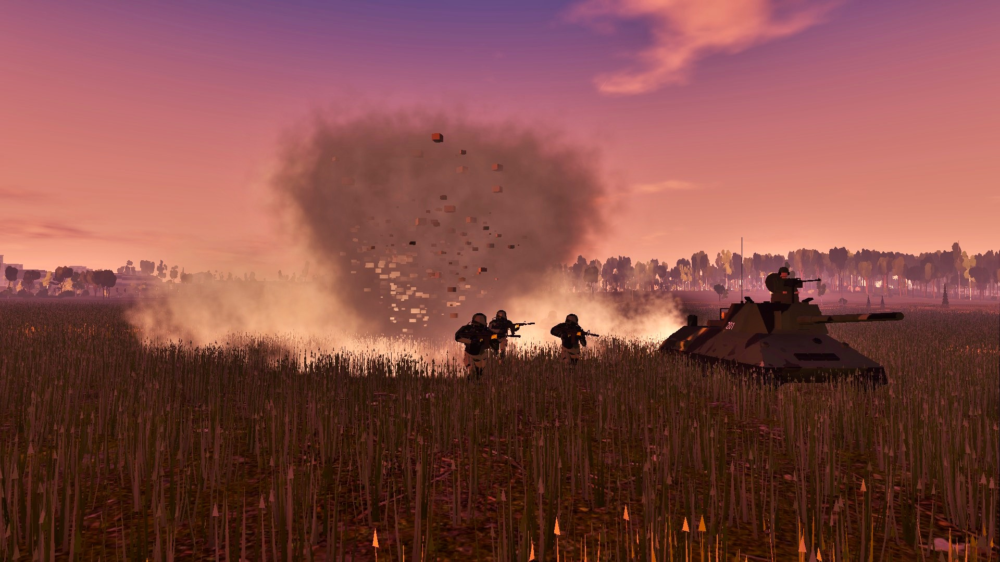

# Vagnstrid

Ett stridsvagnsspel där du är vagnchef i kupolen, i miljöer byggda från öppna data om riktiga
svenska platser: Vidingsjö och Linghem utanför Linköping och vägen genom
Vallastaden till Campus Valla. Träden placeras ut efter laserdata, så skogar och dungar ligger ungefär där de gör i verkligheten, vägarna har sina riktiga bredder
och skyltar, och åkrarna har den gröda som odlades där.

Ett hobbyprojekt, byggt i Godot 4 med all kod skriven av Claude Code.

## Idén

Du sitter i kupolen. **Luckan uppe** ger fri sikt runt om och kikare, men då kan du träffas av
splitter och kulor. **Luckan nere** är säker, men du ser bara genom smala periskop. Det finns
inga markeringar över fienden i 3D-världen. Det du har sett hamnar på minikartan, inget mer.
Bottarna följer samma regler som du: de ser bara det deras vagnchef faktiskt kan se.

## Spellägen

- **King of the Hill:** en zon i taget öppnar, krymper och betalar ut poäng. Lagen strider om den.
- **Thunder Road:** anfallarna ska ta sig fram längs en riktig väg genom checkpoints, försvararna
  ska stoppa dem. Lagen byter sida efter första rundan.
- **Övningskörning och bottjakt** på kartorna (sorteras om inför släppet).

Spela ensam mot bottar, eller med vänner över nätet (se [SPELA_ONLINE.md](SPELA_ONLINE.md)).

## Kontroller

| Tangent | Gör |
|---|---|
| W A S D | Kör |
| Mus | Sikta / titta |
| Vänster musknapp | Skjut (i skyttens sikte), markera fiende (i kupolen) |
| Höger musknapp | Kulspruta |
| H | Lucka upp/ner |
| B | Kikare |
| T | Lägg tornet där du tittar |
| X | Rökgranater |
| M | Stor karta |
| Q | Order till din trupp (karta: vänsterklick = gå dit, högerklick = lägg mina) |
| G | Kalla tillbaka trupp |
| F | Trupp skyddar vagnen |
| V | Se genom truppchefens ögon |
| Tab | Poänglista |
| F3 | Statistik (FPS, nät) |
| Esc | Meny (byt vagn, byt lag, överge vagn, huvudmeny) |

## Vagnarna

Fem förinställda vagnar med var sin tydlig styrka och svaghet: **BT-7** (snabbast, klarar inte
fronter), **T-34** (sluttande pansar, bäst i terräng), **Pz IV** (prickskytt med bästa
siktet), **Sherman** (stabiliserad kanon, skjuter i rörelse) och **KV-2** (152 mm som slår
sönder allt, men långsam). Vagnen väljer du inne i matchen,
efter lagvalet; i garaget kan du titta på dem i förväg.

## Köra spelet

**Färdigt bygge:** packa upp och starta `Vagnstrid.exe` (Windows) eller `Vagnstrid.x86_64` (Linux).

**Från källkoden:** installera [Godot 4.7](https://godotengine.org/download), öppna mappen som
projekt och tryck F5. Första importen tar en stund, eftersom kartorna är stora.

Systemkrav: ett grafikkort med Vulkan-stöd. Kartorna är detaljerade, så ett medelstarkt
spelkort från de senaste åren rekommenderas.

## Hur kartorna byggs

Pipelinen i [`geodata/`](geodata/) hämtar och bearbetar öppna data (Python):

- **Lantmäteriet:** höjdmodell, laserdata och ortofoto. Ur laserpunkterna uppskattas var träden står
  och hur höga de är. Flygfotot ger markens färgvariation.
- **OpenStreetMap:** hus, vägar, järnväg, vatten, lekplatser, busshållplatser, trafikljus, ortnamn.
- **Trafikverket (NVDB):** vägbredd, beläggning, hastighet och övergångsställen, och vägtrummor.
- **Jordbruksverket:** vad som odlas på varje åker, så att man kan ligga gömd i vetet men inte i vallen.
- **Naturvårdsverket (NMD):** marktäcke för allt annat.

Resultatet importeras till Godot med verktygen i [`tools/`](tools/). Bottarnas taktiska karta
(skydd, skog, vägar, vatten) bakas från samma data.

## Tack till

Se [CREDITS.md](CREDITS.md) för alla data, modeller, ljud och bibliotek (finns också under
Credits i huvudmenyn).

## För utvecklare

[CLAUDE.md](CLAUDE.md) är projektets regler och teknisk översikt (skriven för Claude Code, men
läsbar för människor). [EXPORTERA.md](EXPORTERA.md) beskriver hur man bygger spelet.
